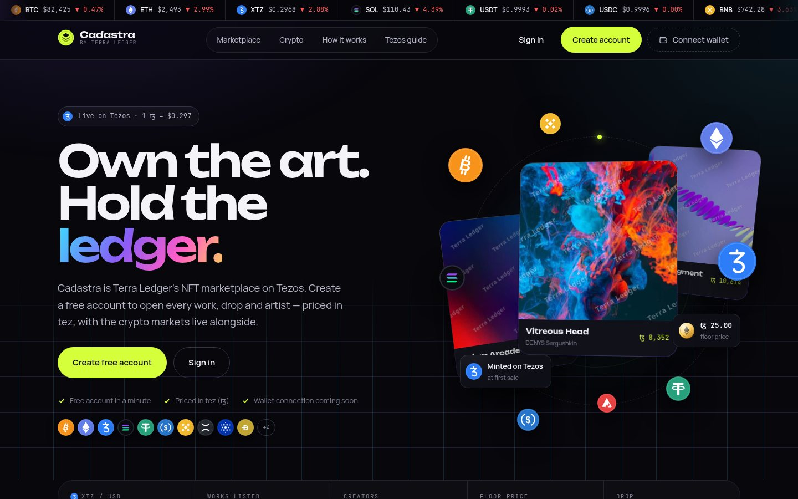

# Cadastra



Cadastra is [Terra Ledger](https://www.terraledger.org/)'s NFT marketplace on Tezos. It is the one
place where everything Terra Ledger tokenizes (buildings, artworks and game collectibles) is
listed, bought and traded.

## Running the project

```bash
nvm install      # the Node.js version in .nvmrc
npm install
npm run dev      # http://localhost:3000
```

## Purpose

Terra Ledger puts ownership records on-chain so that they settle as fast as a message. Its three
programmes each produce tokenized assets on Tezos:

- **Properties:** US buildings, each held in its own SPV and issued as an FA2 token.
- **Editions:** original artworks, digital and physical, minted with full TZIP-21 provenance and a
  10% royalty enforced by the contract.
- **Games:** Terra Ledger's own games, whose players earn collectibles (see
  [Cadastra and the Terra Ledger games](#cadastra-and-the-terra-ledger-games)).

Cadastra was built to give these programmes one shared market. Each programme's output becomes a
liquid asset, and collectors use a single account for property, art and play. Each season,
Terra Ledger also releases drops here with its long-term brand partners. Terra Ledger earns from
primary sales and trading.

### This is a demo

This build shows the experience before any asset moves on-chain. **Every price, account, trade
and figure in it is demo data.** Nothing here is minted, bought or sold on Tezos.

### What the demo does today

| Area | Features |
| --- | --- |
| Marketplace | Landing page with featured works and drops. Explore by category (Art, Real Estate, Gaming) and subcategory, with search. A page for each work. Seasonal drops calendar. Showcase of ten leading NFT artists. |
| Accounts | Free email-and-password accounts. Members-only pages. Signed, revocable sessions. Rate-limited sign-in. |
| Dashboard | Changes with the role. Collectors see market highlights and fairly priced works. The sales team also sees unlisted works, top buyers and designer feedback. |
| Designer review | The sales team shares a private link with a work's designer. The designer sees how the work performs and leaves suggestions, without an account. |
| Media | Original artwork kept private and served through one route. Visitors get watermarked previews, members get clean images. |
| Catalogue | Demo works across the three categories, each with its source and licence recorded. Managed through a CSV import. |
| Prices | Prices in tez with a live USD reference. Live prices for 14 cryptocurrencies. A "New to Tezos?" guide. |

## Cadastra and the Terra Ledger games

Gaming is one of Cadastra's three categories. Its main sources are Terra Ledger's own games, and
Cadastra is meant to be where their players hold and trade what they win:

| Game | What it is | Collectibles it brings to Cadastra |
| --- | --- | --- |
| **Mote Mayhem: Lab Escape** | An arcade escape. Pick one of four Motes, collect eight Energy Cores and dodge security robots to get out of Sector 07 within 90 seconds. | The Motes as characters, plus items earned in play |
| **Twenty-One Showdown** | A multiplayer blackjack-style card game for two to four players, with four table levels and woodland dealer characters (Finn the Fox, Olive the Owl, Bruno the Bear, Cleo the Cat). The server deals every card. | Dealer characters and table rewards |
| **Elemental RPS Arena** | A rock-paper-scissors ladder with 15 collectible tiers, from the Copper Sigil (1 in 2) to the Eternal Singularity (1 in 32,768). Each win unlocks a rarer collectible: claim it, or risk it for the next tier. | Tier collectibles, where rarity is set by the game itself |

Today the demo lists these games' characters and key art as Gaming works. In the full product,
an item a player wins is minted to their wallet and appears in their Cadastra portfolio, ready to
list. The games, the marketplace and the Cadastra account share one identity and one wallet. Some
of these collectibles live on other chains today, and they will need a path onto Tezos.

## Where the project is heading

Development then turns the demo into a live market. The plans below are grouped by system.

### Blockchain (Tezos)

- **Token contracts.** FA2 contracts (TZIP-12) for each collection, with TZIP-21 metadata and
  royalties that other Tezos marketplaces can read.
- **Lazy minting.** Each work is minted at its first sale, using a sale voucher signed by the
  platform. One operation pays the creator, the royalty and the platform.
- **Marketplace contract.** Fixed-price listings, offers and timed auctions, held in escrow.
  The contract is formally specified and independently audited before mainnet.
- **Game collectibles on-chain.** Items won in Mote Mayhem, Twenty-One Showdown and Elemental RPS
  Arena are minted straight to players' wallets. Collectibles from other chains get a bridge or
  migration plan.
- **Drops on-chain.** Allowlists, per-wallet limits and supply caps enforced by the contract.
- **Property tokens.** A transfer policy that checks an on-chain registry of verified investors
  before every transfer, including secondary sales. Rental income paid to holders.
- **Metadata and files.** Metadata and media pinned to IPFS. The full-resolution file stays
  available only to the holder.
- **Ghostnet first.** Every contract and flow runs on the Tezos test network before mainnet.

### Back end

- **Production platform.** Managed PostgreSQL. Staging and production environments. Secrets
  management and automated backups. Original artwork moves to object storage and is served
  through a CDN.
- **Indexer.** Chain events (mints, sales, transfers, offers) flow into the database through TzKT
  or a self-hosted indexer. Ownership, prices, royalties and every figure on the site then come
  from the chain instead of demo data.
- **Accounts.** Email verification, password reset, account deletion and data export. Staff
  sign-in with two-factor authentication and audit logs.
- **Wallet linking.** A wallet is linked to an account by signing a message.
- **Investor verification.** KYC and accreditation checks through a regulated provider, needed
  before any property purchase.
- **Game integration.** A service that receives rewards from the games and queues the mints, so
  a player's winnings reach their portfolio.
- **Catalogue and partners.** An admin console for works, drops, partners and artists, replacing
  the CSV import. A partner console for drop briefs, creator matching and post-drop reports.
- **Scale and safety.** Rate limits and sessions in a shared store (Redis), so the site can run
  on several servers. Structured logs, error tracking and alerting. A takedown process,
  detection of suspicious trading, and flagging of stolen assets.
- **Partner API.** A read API for listings, prices and sales.
- **Card payments.** Checkout by card through a regulated on-ramp partner.

### Front end

- **Wallet connection.** Beacon / octez.connect for Tezos wallets (Temple, Kukai, Umami), plus
  WalletConnect v2.
- **Buying flows.** Buy, offer and bid, with clear fees, wallet confirmation and transaction status
  from pending to confirmed, without leaving the page.
- **Portfolio.** Holdings, open offers and sale history for each member, including collectibles
  won in the games.
- **Discovery.** Collection pages with floor price, volume and owners. Traits and rarity for game
  items, such as the Elemental RPS Arena tiers. Full-text search with filters.
- **Live drops.** Countdowns, allowlist status and mint progress.
- **Creators.** Creator profiles, verification badges, and a flow to upload and list a work with
  its licence and provenance.
- **Engagement.** Favourites, watchlists, an activity feed, and notifications for outbids, sales
  and drop openings.
- **Property pages.** Documents, occupancy, valuation history and holder statements.
- **Cadastra Pass.** Member and holder benefits, such as early drop access and lower fees,
  applied automatically.
- **Reach.** An installable mobile app (PWA) with wallet deep links. Translation for the first
  launch markets. Accessibility to WCAG 2.2 AA.
- **Launch content.** Original artwork and property photographs in place of the demo images.
